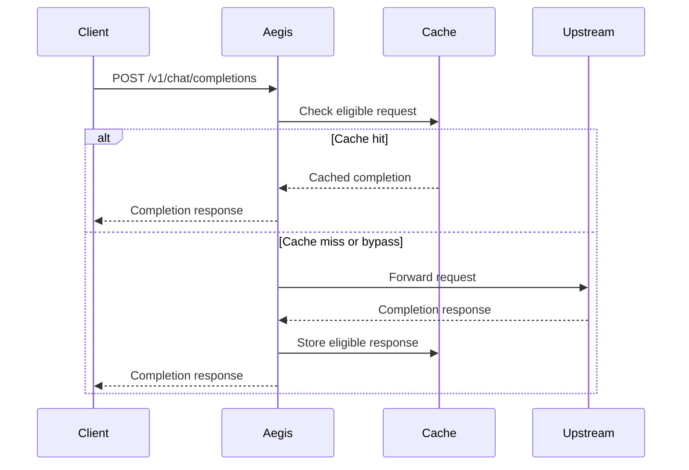
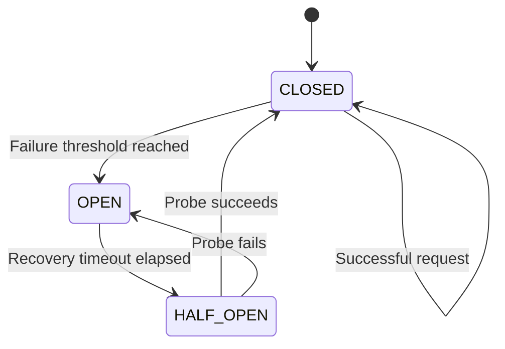
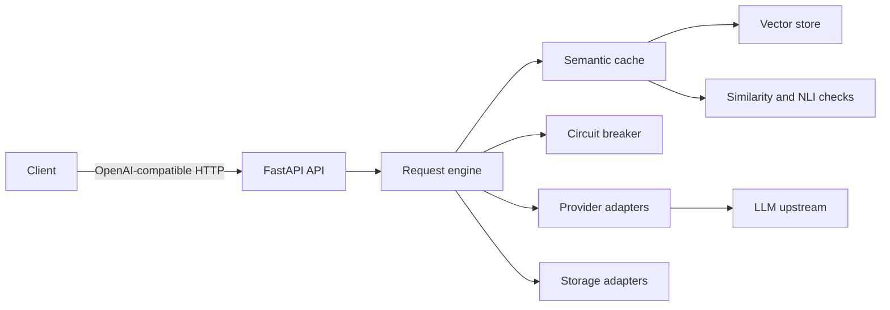

# Aegis architecture

These diagrams describe the intended gateway flow. In Phase 0, only the HTTP API
exists; cache lookup, upstream forwarding, and circuit-breaker behavior are not
implemented yet.

## Request and response flow

## Circuit breaker state machine

## Components

